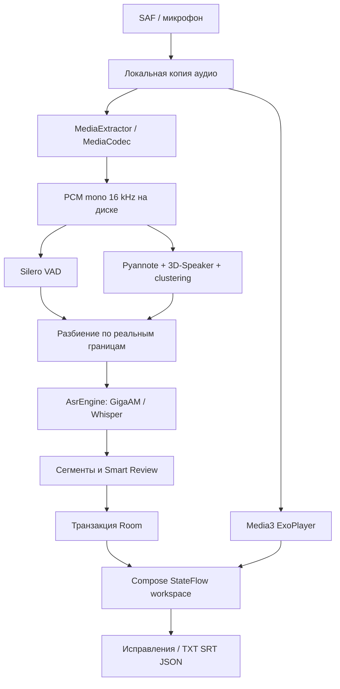

# Актуализация V1.6

ML/storage архитектура ниже сохранена. Изменён нативный слой записи: RecordingHome → центрированный LiquidVoiceOrb + отдельный LiveMicrophoneMeter overlay; ReplikaRoot → общая прокручиваемая decision sheet с pause/resume и двумя исходами. AppViewModel очищает UI elapsed после финализации, сохраняя durationMs аудио. Переносимый build entrypoint — tools/build_portable.py, входы — model-pack и src/main/jniLibs; старый build_local.py машинно-зависим. См. HANDOFF.md и TEST_REPORT_V1_6.md.

---

# Архитектура

## All-in-One provisioning · V1.2.1

Обычный debug APK сохраняет прежний механизм установки моделей. Отдельный `allInOne` build type включает только arm64-v8a и один generated asset `offline/replika-models.zip`; `allInOneQa` использует x86_64 и изолированный applicationId `.aioqa`. Веса не хранятся в Git: Gradle вызывает `tools/prepare_embedded_pack.py` только перед объединением assets этих двух вариантов. Скрипт проверяет существующий локальный ZIP по `models-lock.json`, потоково перепаковывает DEFLATE и повторно сверяет восемь файлов; исходный пакет не меняется.

`ReplikaApp.bundledModels` запускает application-scoped IO-задачу. `MainActivity` показывает `ModelPreparationScreen` до готовности и откладывает создание `AppViewModel`. Координатор держит существующий `ModelManager.gate` на протяжении проверки и установки. Worker ожидает готовность **до** захвата этого gate; native ASR/VAD/diarization и путь `files/models` остаются прежними. Стандартный APK сразу получает состояние READY без provisioning IO.

`BundledModelInstaller` проверяет размеры/SHA-256 live-файлов. При полном валидном комплекте ZIP не открывается и файлы не перезаписываются. Недостающие файлы потоково пишутся в `files/bundled-model-staging/<manifest fingerprint>`, проверяются по размеру, SHA-256 и ZIP CRC. Ограничены пути, количество/размер служебных записей и объём распаковки; свободное место проверяется с резервом 32 МиБ. После проверки **всего** архива и staged-файлов каждый нужный файл публикуется атомарным rename на том же файловом разделе, под gate. Это не единая транзакция восьми rename: при убийстве процесса между rename следующий запуск повторно проверит live/staging. Native не может увидеть промежуточный комплект, поскольку после перезапуска снова действует gate и ожидание готовности.

Частичные файлы удаляются только из собственного staging; завершённые файлы повторно хешируются и могут быть использованы при повторе. Существующие модели, Room и аудио при ошибке не удаляются. Прогресс означает фактически прочитанные байты текущей стадии. Технические результаты и исходные ошибки сохраняются в `files/provisioning-diagnostics/`; повтор и offline-восстановление доступны из UI. Наличие реализации не заменяет результаты Android-проверок в `TEST_REPORT.md`.

Один Android Gradle module с границами пакетов `domain`, `data`, `ml`, `ui`. Выделение в несколько Gradle-модулей отложено: доменная логика уже отделена от Android, но проект пока не является строгой многомодульной Clean Architecture.

`ReplikaApp` владеет Room и ModelManager. `AppViewModel` управляет библиотекой, записью, импортом и редактированием. Room Flow обновляет интерфейс. `ProcessingWorker` выполняет ML на Dispatchers.Default; файловые операции декодирования и импорта — на IO. Каждая запись имеет уникальное задание WorkManager; повторное нажатие не создаёт дубликат. Общий Mutex последовательно допускает тяжёлые процессы и исключает одновременный inference и удаление/замену весов. Ошибка или отмена одной записи не блокирует независимые задания.

В каждом запуске модели создаются и освобождаются через `finally` / `use`. GigaAM streams освобождаются после каждой фразы. Диаризация освобождается до загрузки ASR. VAD читает PCM блоками по 512 отсчётов; ASR читает только очередной участок. Нативный API диаризации 2.0.1 требует непрерывный FloatArray всей записи. Это основное ограничение длинных файлов.

## Время и сопоставление

MediaCodec PTS привязывает декодированные отсчёты к оригинальной шкале. Каналы усредняются, исходная громкость сохраняется, перед понижением частоты применяется 63-tap windowed-sinc FIR anti-alias фильтр, затем линейная интерполяция. Задержка FIR компенсируется в шкале PTS и дополняется хвостом в конце потока.

VAD-интервалы объединяются. Внутри них строится разбиение на границах интервалов диаризации. Соседние части с одинаковым speaker assignment и причинами объединяются до ограничения длины, чтобы не дробить одного говорящего искусственно. Каждый непересекающийся участок распознаётся один раз. При единственном активном участнике он получает его ID; при нуле или нескольких — `-1`. Длинные интервалы разбиваются на 20-секундные части и получают предупреждение о границе слов. К VAD добавляется 100 ms pre-roll (post-roll 0); расширение ограничивается файлом, затем интервалы объединяются. ASR-участки остаются непересекающимися, исходная шкала времени сохраняется. Повторного распознавания нахлёста нет. На границах возможны обрезанные слова; это отмечается для проверки, но не устраняется фиктивным распределением текста.

ID говорящих перенумеровываются по первому появлению и сохраняются в пределах записи. Они не являются биометрическими идентификаторами. Если sherpa возвращает пересечение, оно помечается; отсутствие пересечения в результате не доказывает отсутствие одновременной речи в оригинале.

Сегмент содержит UUID, startMs/endMs, speakerId, текст, источник, edited, reviewed и причины предупреждений. Нативная confidence не используется: она не является калиброванной вероятностью ошибки. Метки сегментные. Исходные интервалы диаризации сохраняются отдельно в JSON диагностики для DER.

## Хранение и фон

Приватный каталог `files/audio` содержит оригиналы, `files/models` — проверенные веса, Room — записи/реплики/имена. PCM в cache удаляется после успеха, ошибки или завершённой отмены. Незавершённый файл `.installing` никогда не передаётся inference. `.part` сохраняется при сетевой отмене; повторная загрузка проверяет HTTP Range, размер и SHA-256.

Worker повышается до foreground через WorkManager с типом dataSync и уведомлением отмены. На Android 15/16 действуют системные ограничения времени foreground service и квот WorkManager. Процесс, принудительно остановленный системой, может повторить обработку с начала; checkpoint ML не реализован. Завершение записывается одной Room-транзакцией, частичная стенограмма не выдаётся за готовую.

Отмена проверяется между блоками и ASR-участками. Текущий JNI ASR не прерывает выполняющийся нативный вызов. Используется обычный `process()`: callback JNI v2.0.1 обращается к специализированному invoke(IIJ) и несовместим с invokedynamic-лямбдой Kotlin 2.1 (подтверждён Android SIGABRT). Возврат callback upstream также не гарантирует прерывания вычислений. UI сразу показывает CANCELLING, завершённая отмена сохраняется внутри ML mutex после возврата нативного этапа. Прямой cancel action уведомления удалён: уведомление открывает приложение. AppViewModel сверяет оставшиеся busy-состояния с фактическим WorkManager и восстанавливает отменённое/ошибочное состояние без удаления сохранённых сегментов. Немедленная безопасная отмена требует изоляции ML в отдельном процессе или изменения upstream API.

## Диагностика V1.1

Режим clustering automatic/fixed, фактические параметры segmentation/VAD и контекста, сырые turns/VAD spans, все ASR slices (включая пустые результаты), раздельные load/inference/IO/thermal timings сохраняются в JSON. Пустой ASR slice не маскируется демонстрационной репликой. Room получает только фактически непустые гипотезы; качество пропусков требует сравнения с эталоном. Ограниченное расширение VAD проверяется отдельным экспериментом с объединением нахлёстов и сохранением исходной шкалы времени.

## V1.2: представление и целостность ручных данных

ML/Worker/Alignment и model lock сохранены относительно `6e3c8ab`. UI разделён на Workspace, TranscriptEditor, SmartReview, Models и общие продуктовые компоненты. Speaker цвета семантически отделены от синего действия/позиции воспроизведения; timestamps остаются сегментными.

Room schema остаётся v1. `TranscriptSnapshot` читает recording/segments/speakers транзакционно; UI различает загрузку и пустой результат. Поиск текста наблюдает таблицу segments через Flow. `ProductStorage` проверяет исходную версию строки перед правкой и Undo. История Undo ограничена последней ручной правкой текущей сессии. Снимок редактируемой строки и несохранённый черновик сохраняются через SavedInstanceState при пересоздании Activity; это не постоянная история черновиков после force-stop.

Удаление допускается после проверки WorkManager и под общим native gate. В транзакции удаляются recording, segments и speaker names. Принадлежащий приложению прямой файл `files/audio` сначала переносится в `.deleting`; ошибка SQLite возвращает файл, запуск восстанавливает прерванное удаление. Внешние пути, shared audio и выходящие за audio symlink-цели сохраняются. Модели не входят в область удаления.

Ошибки имеют пользовательское русское объяснение; исходный stack/code остаётся в app-private `files/diagnostics/last-ui-error.json`. Основная диагностика показывает только существующие поля. PSS — снимок, не peak; старый `asrMs` не называется чистым inference. Подробный JSON и Share доступны отдельным действием.
