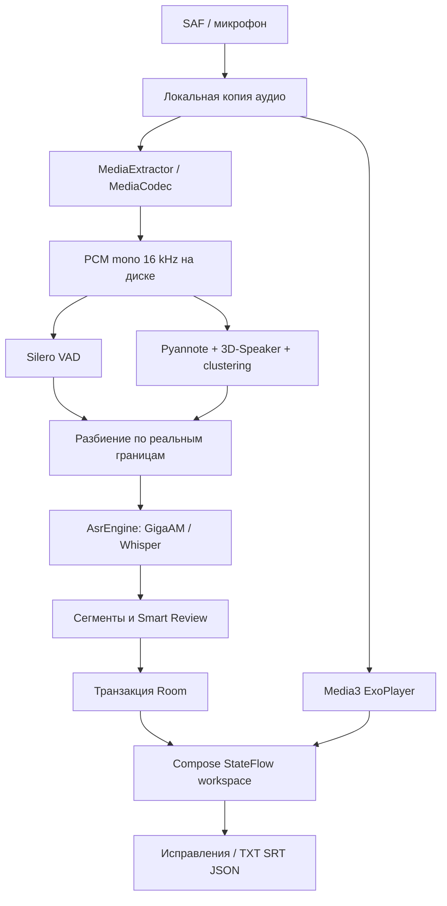

# Архитектура

Один Android Gradle module с границами пакетов `domain`, `data`, `ml`, `ui`. Выделение в несколько Gradle-модулей отложено: доменная логика уже отделена от Android, но проект пока не является строгой многомодульной Clean Architecture.

`ReplikaApp` владеет Room и ModelManager. `AppViewModel` управляет библиотекой, записью, импортом и редактированием. Room Flow обновляет интерфейс. `ProcessingWorker` выполняет ML на Dispatchers.Default; файловые операции декодирования и импорта — на IO. Каждая запись имеет уникальное задание WorkManager; повторное нажатие не создаёт дубликат. Общий Mutex последовательно допускает тяжёлые процессы и исключает одновременный inference и удаление/замену весов. Ошибка или отмена одной записи не блокирует независимые задания.

В каждом запуске модели создаются и освобождаются через `finally` / `use`. GigaAM streams освобождаются после каждой фразы. Диаризация освобождается до загрузки ASR. VAD читает PCM блоками по 512 отсчётов; ASR читает только очередной участок. Нативный API диаризации 2.0.1 требует непрерывный FloatArray всей записи. Это основное ограничение длинных файлов.

## Время и сопоставление

MediaCodec PTS привязывает декодированные отсчёты к оригинальной шкале. Каналы усредняются, исходная громкость сохраняется, перед понижением частоты применяется 63-tap windowed-sinc FIR anti-alias фильтр, затем линейная интерполяция. Задержка FIR компенсируется в шкале PTS и дополняется хвостом в конце потока.

VAD-интервалы объединяются. Внутри них строится разбиение на границах интервалов диаризации. Каждый непересекающийся участок распознаётся один раз. При единственном активном участнике он получает его ID; при нуле или нескольких — `-1`. Длинные интервалы разбиваются на 20-секундные части и получают предупреждение о границе слов. Контекстные перекрытия ASR не используются, поэтому дубли от нахлёстов не возникают. На границах возможны обрезанные слова; это отмечается для проверки, но не устраняется фиктивным распределением текста.

ID говорящих перенумеровываются по первому появлению и сохраняются в пределах записи. Они не являются биометрическими идентификаторами. Если sherpa возвращает пересечение, оно помечается; отсутствие пересечения в результате не доказывает отсутствие одновременной речи в оригинале.

Сегмент содержит UUID, startMs/endMs, speakerId, текст, источник, edited, reviewed и причины предупреждений. Нативная confidence не используется: она не является калиброванной вероятностью ошибки. Метки сегментные. Исходные интервалы диаризации сохраняются отдельно в JSON диагностики для DER.

## Хранение и фон

Приватный каталог `files/audio` содержит оригиналы, `files/models` — проверенные веса, Room — записи/реплики/имена. PCM в cache удаляется после успеха, ошибки или завершённой отмены. Незавершённый файл `.installing` никогда не передаётся inference. `.part` сохраняется при сетевой отмене; повторная загрузка проверяет HTTP Range, размер и SHA-256.

Worker повышается до foreground через WorkManager с типом dataSync и уведомлением отмены. На Android 15/16 действуют системные ограничения времени foreground service и квот WorkManager. Процесс, принудительно остановленный системой, может повторить обработку с начала; checkpoint ML не реализован. Завершение записывается одной Room-транзакцией, частичная стенограмма не выдаётся за готовую.

Отмена проверяется между блоками и ASR-участками. Текущий JNI ASR не прерывает выполняющийся нативный вызов. Callback диаризации upstream 2.0.1 не гарантирует остановку вычислений при возвращении ненулевого значения. UI и сохранение реагируют после возврата нативного этапа. Немедленная безопасная отмена требует изоляции ML в отдельном процессе или изменения upstream API.
