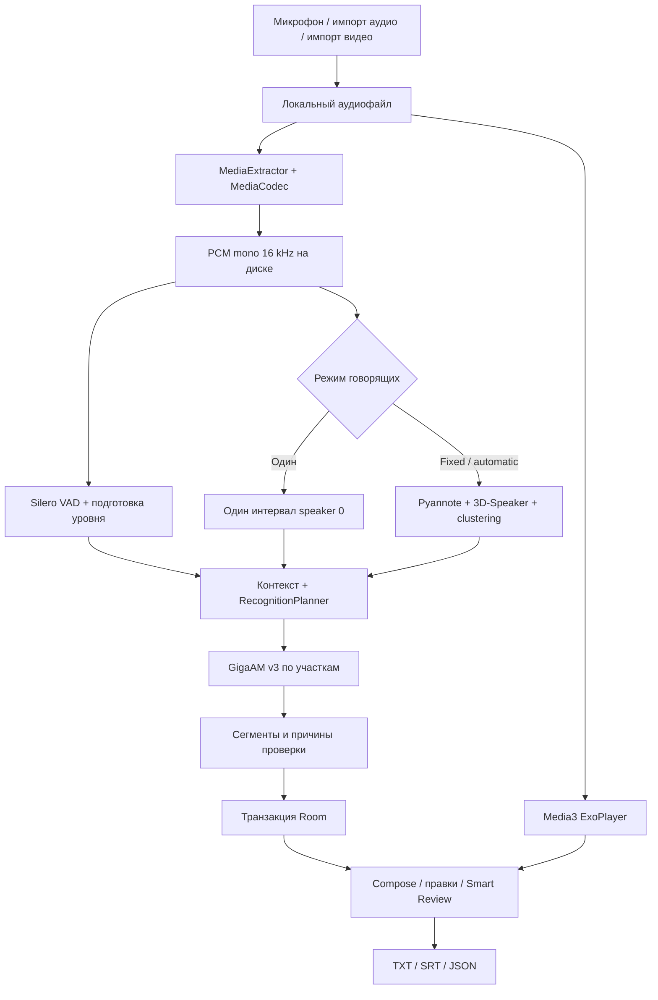

# REPLIKA Android — полный обзор проекта

Активная работа идёт по [PLAN_19H.md](PLAN_19H.md). Текущий этап и доказательства:
[STATUS.md](STATUS.md), [журнал изменений](UPDATES.md), [решения](DECISIONS.md).
Документ ниже описывает базовый срез V1.6; результаты нового цикла приведены здесь
и в отдельных отчётах. Исторические результаты не подменяют свежую приёмку.

V1.6 сохранена коммитом `3aba648` и отдельным APK; проект опубликован в приватном GitHub.
Пункт 1 добавил строгий JSON жюри и automatic по умолчанию. Прежний расширенный JSON
доступен как диагностический. Пункт 2 создал [воспроизводимый стенд](tools/eval/README.md)
с независимыми эталонами и [baseline](docs/TEST_RESULTS.md).

Пункт D добавил ASR по VAD и назначение говорящих словам по реальным RNNT timestamps.
Профиль context600 прошёл host-проверки и настоящий Android-прогон фиксированной пятёрки:
raw WER 43/442 = 9,73%, расхождение с ПК −0,226 п.п. APK опубликован отдельно.
[Отчёт D](docs/STEP_03_VAD_WORD_ASR.md) сохраняет ограничения таймингов и скорости.

Сейчас выполняется пункт C. Проверены шесть эмбеддеров: 48 fixed-K и 672 automatic
SD-прогона. Выбран экспериментальный C2 на исходном ERes2Net: native threshold 0,30,
измеренные окна и cosine average clustering τ=0,36. Полные новые host-прогоны 23 файлов
и независимый аудит 3164 проверок завершены: правильное K — dev 7/8, holdout 4/5,
reserve 5/10; DER — 18,30%, 13,89%, 22,44%. На отдельной естественной встрече AMI C2
ошибся в K на всех трёх связанных фрагментах; общей точности диалогов эти RU-gates не доказывают.
[Отчёт C и реальные outputs](docs/STEP_04_DIARIZATION.md).

Kotlin C2 совпал с Python на 157 проверках, включая все 23 реальных файла.
Первый Android-smoke завершил ML/ASR до READY, но SELinux запретил hardlink для QA.
Публикация заменена на atomic rename под файловой блокировкой. Новый APK прошёл
173 JVM-теста, static arm64, проверку подписи и две UI-проверки; полный Python-набор —345PASS.
Повторный настоящий smoke и независимый replay прошли: четыре512dimэмбеддинга,
42токена→14слов→точныйJSON. Полный Android-прогон10/10 прошёл заданные proxy-gates: devK7/8/DER18,30%,
fixedfiveWER43/442=9,73% иΔПК−0,226п.п. Независимый native-аудит564checksPASS;32дополнительныеminOff/shiftпробыотклонены.
КонтрольныйAPKне меняется, финальныеGit/Releaseготовятся.
Это не общая приёмка естественного диалога/ARM/скорости. Семь весов и модельный pack1.5 прежние.

Обычные ML-defaults пока `v16`. Кандидат включается флагами
`-PreplikaAsrPlan=vad_words_context600 -PreplikaDiarPlan=eres2net_window_v1`;
старые WorkData и ручное K сохраняют legacy-путь. Полная приёмка Android-конвейера,
таймингов, скорости и ARM ещё открыта. LLM, Lite и лендинг отложены до core acceptance.
**WER/DER — доля ошибок, меньше лучше.** 3% normalized WER не означает 3% успеха:
[как читать метрики](tools/eval/SCORING.md).

Срез рабочей папки на **6 ноября 2026 года**. Приложение **V1.6 / versionCode 8**, комплект моделей **V1.5**. Документ объединяет назначение приложения, стек, устройство кода, модели, историю изменений, эксперименты и ограничения. Детальные отчёты и исходные доказательства доступны по ссылкам ниже.

Основной обзор составлен по срезу V1.6 от 6 ноября: коду, Gradle, model manifest и прежним отчётам. Свежие сборки и inference цикла PLAN_19H вынесены в ссылки выше; испытания на физическом телефоне в этом цикле не выполнялись. Исторические числа ниже не подменяют свежие результаты.

## Содержание

- [Что делает приложение](#что-делает-приложение)
- [Текущее состояние и источники истины](#текущее-состояние-и-источники-истины)
- [Технологический стек](#технологический-стек)
- [Карта репозитория](#карта-репозитория)
- [Архитектура и обработка записи](#архитектура-и-обработка-записи)
- [Какие модели используются](#какие-модели-используются)
- [Что уже делали с моделями и звуком](#что-уже-делали-с-моделями-и-звуком)
- [История разработки](#история-разработки)
- [Данные, правки и экспорт](#данные-правки-и-экспорт)
- [Интерфейс и запись](#интерфейс-и-запись)
- [Сборка, модели и перенос](#сборка-модели-и-перенос)
- [Проверки и доказательства](#проверки-и-доказательства)
- [Что остаётся незавершённым](#что-остаётся-незавершённым)
- [Навигатор по подробной документации](#навигатор-по-подробной-документации)
- [Как поддерживать этот обзор](#как-поддерживать-этот-обзор)

## Что делает приложение

REPLIKA — нативное Android-приложение для записи и локального распознавания русской речи. Основной сценарий: записать голос или импортировать файл, получить стенограмму с временными интервалами и говорящими, проверить её по оригинальному звуку, исправить и экспортировать.

Реализованы:

- Микрофонная запись в AAC/M4A с паузой, продолжением и выбором сохранения/удаления.
- Импорт аудио через системный файловый выборщик; локальное извлечение аудиодорожки из видео.
- Поиск речи, распознавание и диаризация — разделение по говорящим. Есть явные режимы одного говорящего, фиксированного числа 2–20 и автоматического определения числа участников.
- Библиотека, плеер, переход от реплики к звуку, представления «Диалог» и «Чтение».
- Ручные правки текста и говорящего, переименование участников, отметка проверки, отмена последней правки текущей сессии.
- Smart Review — очередь фрагментов с вычисленными причинами для проверки.
- Экспорт TXT/SRT/JSON через системное меню Share, диагностический JSON.
- Светлая и графитовая темы, локальное сохранение оформления.

Распознавание выполняется на устройстве. В текущем продуктовом конвейере нет облачного ASR, LLM, генерации резюме или отдельного серверного backend. Сеть используется для явной загрузки моделей; All-in-One содержит их внутри APK. Наличие классов TTS, denoiser и других возможностей в сторонних bindings sherpa не означает, что эти функции используются приложением.

## Текущее состояние и источники истины

| Что | Актуальное значение / источник |
| --- | --- |
| Android-приложение | `ru.replika.offline`, V1.6, code 8 — [app/build.gradle.kts](app/build.gradle.kts) |
| ML pack | V1.5: GigaAM v3 + VAD + диаризация — [models-lock.json](app/src/main/assets/models-lock.json) |
| Сохранённый базовый артефакт V1.6 | `release/REPLIKA-V1.6-AllInOne-arm64.apk`, 306 312 754 байта — [CURRENT.json](release/CURRENT.json) |
| Схема локальной БД | Room version 1 — [Database.kt](app/src/main/java/ru/replika/data/Database.kt) |
| Текущее состояние / ограничения | [PROJECT_STATE.md](PROJECT_STATE.md), [KNOWN_ISSUES.md](KNOWN_ISSUES.md) |
| Базовый цикл проверок V1.6 | [TEST_REPORT_V1_6.md](TEST_REPORT_V1_6.md); свежие — [STATUS.md](STATUS.md) |
| Продолжение работы / перенос | [AGENTS.md](AGENTS.md), [HANDOFF.md](HANDOFF.md), [PORTABILITY.md](PORTABILITY.md) |

**Версия приложения и версия моделей различаются:** в V1.6 изменяли UI и переносимость, ML-конвейер V1.5 сохранили.

При первоначальном обзоре в рабочей папке было много изменённых и untracked файлов. Git HEAD тогда был `ce34556` от 04.11.2026, с реализацией V1.3; V1.4–V1.6 тогда существовали дальнейшей работой в дереве. В пункте 0 PLAN_19H эта работа зафиксирована снимком `3aba648`; дальнейшие коммиты имеют фактические даты нового цикла. Поэтому одного `git log` или clone текущего HEAD недостаточно для восстановления актуального состояния.

README, PROJECT_STATE и ARCHITECTURE содержат исторические разделы. [MODEL_RESEARCH.md](MODEL_RESEARCH.md) описывает первоначальные GigaAM v2 и Whisper; актуальный выбор — в [MODEL_SELECTION_V1_5.md](MODEL_SELECTION_V1_5.md). В старом `docs/licenses/NOTICE.md` также остаются прежние компоненты; текущий notice поставки — [app/src/main/assets/licenses/NOTICE.md](app/src/main/assets/licenses/NOTICE.md). Состав текущего APK следует сверять с Gradle, manifest моделей и версионным отчётом.

## Технологический стек

Версии взяты из конфигурации проекта, а не из актуального внешнего каталога библиотек.

| Слой | Технологии и закреплённые версии |
| --- | --- |
| Язык / JVM | Kotlin 2.1.20, Java/JVM target 17, JDK 17 |
| Сборка | Gradle Wrapper 8.13, Android Gradle Plugin 8.9.2, KSP 2.1.20-1.0.32 |
| Android | minSdk 26 / Android 8.0, compileSdk и targetSdk 35; Build Tools 35.0.0 в инструкции окружения |
| UI | Jetpack Compose BOM 2025.04.01, Material 3, Material Icons Extended, Activity Compose 1.10.1 |
| Состояние / lifecycle | ViewModel Compose и Runtime Compose 2.8.7, Flow/StateFlow, kotlinx.coroutines Android 1.10.2 |
| Хранение | Room runtime/ktx/compiler 2.7.1, DataStore Preferences 1.1.4; отдельные настройки используют SharedPreferences |
| Фоновые задания | WorkManager 2.10.1, CoroutineWorker, foreground service типа `dataSync` |
| Запись / импорт | Android MediaRecorder, MediaExtractor, MediaCodec, MediaMuxer, Storage Access Framework |
| Воспроизведение | Media3 ExoPlayer 1.6.1 |
| ML runtime | sherpa-onnx 2.0.1, ONNX Runtime 1.28.2 по текущему notice, JNI, CPU provider |
| Native inputs | Готовые `.so` для arm64-v8a и x86_64; NDK 27.2.12479018 для build/strip задач |
| Рендер шара | Compose Canvas/Path; AGSL RuntimeShader с API 33, Canvas fallback для API 26–32 |
| Архивы / платформенные утилиты | Apache Commons Compress 1.27.1, AndroidX Core KTX 1.16.0, FileProvider |
| Шрифты | Onest из ресурсов; serif для бренда и заголовков |
| JVM-тесты | JUnit 4.13.2, org.json 20250107 |
| Android-тесты | AndroidX Test JUnit 1.2.1, runner 1.6.2, Espresso 3.6.1, Compose UI Test |
| Инструменты | Python 3.12+, adb, SDK tools; отдельные host-исследования имеют дополнительные зависимости и датасеты |

Это один Gradle-модуль `:app` с пакетами `domain`, `data`, `ml`, `ui`. Объекты приложения создаются в `ReplikaApp`; строгая многомодульная Clean Architecture и отдельный DI framework здесь не введены. Нативный UI реализован на Kotlin/Compose. `design-lab/` и веб-концепты используются как дизайн-референсы.

Источники зависимостей: [корневой Gradle](build.gradle.kts), [Gradle приложения](app/build.gradle.kts), [settings](settings.gradle.kts), [wrapper](gradle/wrapper/gradle-wrapper.properties), [AndroidManifest](app/src/main/AndroidManifest.xml).

## Карта репозитория

| Путь | Назначение |
| --- | --- |
| [app/src/main/java/ru/replika](app/src/main/java/ru/replika) | Собственный Kotlin-код приложения |
| [ReplikaApp.kt](app/src/main/java/ru/replika/ReplikaApp.kt), [MainActivity.kt](app/src/main/java/ru/replika/MainActivity.kt) | Владение БД/моделями, запуск и корневой UI |
| [domain/](app/src/main/java/ru/replika/domain) | Сегменты, выравнивание, RecognitionPlanner, экспорт, метрики, подготовка тихого входа, представление стенограммы |
| [data/](app/src/main/java/ru/replika/data) | Room/DAO, безопасные правки и удаление, журнал импорта, настройки темы |
| [ml/](app/src/main/java/ru/replika/ml) | Декодирование, импорт медиа, provisioning моделей, ASR, Worker, telemetry |
| [ui/](app/src/main/java/ru/replika/ui) | Главная, библиотека, редактор, review, плеер, модели, тема и шар |
| [com/k2fsa/sherpa/onnx/](app/src/main/java/com/k2fsa/sherpa/onnx) | Сторонние Kotlin bindings; должны соответствовать версии native runtime |
| `app/src/main/jniLibs/` | Игнорируемые Git `.so`: `libonnxruntime.so`, `libsherpa-onnx-jni.so` для двух ABI |
| [app/src/main/assets/](app/src/main/assets) | Model lock и лицензии, включаемые в приложение |
| `model-pack/` | Локальные веса и ZIP, включая текущий и исторические комплекты; игнорируется Git |
| [app/src/test/](app/src/test), [app/src/androidTest/](app/src/androidTest) | JVM и Android/instrumentation тесты, небольшие codec fixtures |
| [tools/](tools) | Сборка, верификация, staging, benchmarks, сбор evidence и review-пакетов |
| [benchmark/](benchmark) | Формат эталонов, методики и локальные smoke fixtures; не все датасеты хранятся здесь |
| [docs/](docs) | Evidence по версиям, лицензии, human review и дизайн |
| [design-lab/](design-lab) | Веб-референсы, концепты и история визуальных исследований |
| [release/](release) | Текущий APK, описание и суммы; прежние артефакты в `release/archive/` |
| `review/`, [archive/](archive) | Предыдущие review-материалы, диагностика и отдельный видеоэксперимент |
| `local-dev/` | Приватный прежний debug-keystore и локальные настройки/кэши; игнорируется Git |

## Архитектура и обработка записи



1. **Вход.** `AppViewModel` управляет записью и импортом. `MediaImporter` копирует аудио либо извлекает его из видео: AAC может remux-иться в M4A без перекодирования; fallback декодируется в WAV. `IsoBmffAudioTimeline` учитывает MP4-временную шкалу. `ImportJournal` помогает убрать незавершённые результаты после прерывания. Оригинал выбранного файла не перезаписывается.
2. **Очередь.** `ProcessingWorker` запускается как уникальная WorkManager-задача `replika-<recordingId>` с политикой KEEP. Сначала он ждёт готовность встроенных моделей, затем захватывает общий `ModelManager.gate`. Этот mutex координирует тяжёлую обработку и операции с моделями.
3. **Декодирование.** `AudioDecoder` получает PCM mono 16 kHz и пишет Float32 на диск. Каналы усредняются, перед downsampling применяется FIR anti-alias фильтр, учитываются PTS и задержка фильтра. Основной PCM сохраняет исходный уровень; из реальных амплитуд строятся peaks для UI.
4. **VAD.** Silero читает блоки по 512 отсчётов. Для тихого входа используется ограниченный gain временных буферов. После полностью пустого первого прохода возможен отдельный detector-only retry; детали ниже.
5. **Говорящие.** В single-режиме создаётся один Turn на всю запись с ID 0; segmentation/embedding/clustering не загружаются. В fixed/automatic Pyannote и 3D-Speaker вычисляют turns. Native API требует FloatArray всей записи; перед выделением Worker проверяет запас Java heap.
6. **Планирование ASR.** К VAD добавляются pre-roll 100 ms и post-roll 0 ms. `RecognitionPlanner` сопоставляет речь и turns, восстанавливает короткие однозначные края, сохраняет неоднозначность и overlap как предупреждения. ASR-срезы не пересекаются; максимальная длина — 20 секунд.
7. **Распознавание.** `GigaAmEngine` создаёт sherpa `OfflineRecognizer`, читает очередной PCM-срез и освобождает stream после фразы. Диаризатор освобождается до загрузки ASR. Если срезов нет, recognizer вообще не создаётся. Пустые гипотезы учитываются в диагностике, в Room не создаются фиктивные реплики.
8. **Завершение.** Запись и сегменты публикуются транзакционно; Room Flow обновляет UI. PCM из cache удаляется при завершении, ошибке или окончательной отмене. Native ресурсы освобождаются через `finally`/`use`.

**Фон, отмена и нагрев.** WorkManager продолжает обработку независимо от Activity; запись микрофона при уходе в фон ставится на паузу. При thermal status SEVERE+ приложение ждёт охлаждения перед следующей тяжёлой операцией. Отмена проверяется между блоками и стадиями, но текущий JNI-вызов не прерывается немедленно. После смерти процесса обработка может начаться заново: ML-checkpoint отсутствует. Небезопасный callback диаризации не используется из-за зафиксированной несовместимости JNI с Kotlin invokedynamic.

Ключевые файлы: [ProcessingWorker.kt](app/src/main/java/ru/replika/ml/ProcessingWorker.kt), [AudioDecoder.kt](app/src/main/java/ru/replika/ml/AudioDecoder.kt), [AsrEngine.kt](app/src/main/java/ru/replika/ml/AsrEngine.kt), [Transcript.kt](app/src/main/java/ru/replika/domain/Transcript.kt), [PipelineTelemetry.kt](app/src/main/java/ru/replika/ml/PipelineTelemetry.kt). Дополнительное описание: [ARCHITECTURE.md](ARCHITECTURE.md).

## Какие модели используются

Текущий [models-lock.json](app/src/main/assets/models-lock.json) закрепляет **7 файлов общим размером 278 127 730 байт**. Для каждого указаны путь, источник, размер и SHA-256. Это проверка конкретных файлов; измеренные хеши не являются подписью издателя.

| Задача | Модель / файлы относительно `model-pack/` | Размер, байт | Лицензия по материалам поставки |
| --- | --- | ---: | --- |
| Русский ASR | GigaAM v3 E2E RNNT, `giga-v3/encoder.int8.onnx`, `decoder.onnx`, `joiner.onnx`, `tokens.txt` | 231 897 202 | MIT |
| Детектор речи | Silero VAD, `vad/silero_vad.onnx` | 643 854 | MIT |
| Сегментация говорящих | Pyannote segmentation 3.0, `diar/segmentation.onnx` | 5 992 913 | MIT |
| Speaker embeddings | 3D-Speaker ERes2Net base, `diar/embedding.onnx` | 39 593 761 | Apache-2.0 |

Это четыре компонента моделей; в manifest они объединены в три группы `giga-v3`, `vad`, `diar`. Clustering — алгоритм runtime, отдельного файла весов у него нет.

**ASR.** Используется готовая sherpa ONNX-конверсия GigaAM v3 с пунктуацией и регистром, revision `a6039be7cee829a9044a69ac0ebaf1c191217c97`. INT8 относится к энкодеру; decoder и joiner — отдельные ONNX-файлы. Production decoding — greedy, `modelType=nemo_transducer`, CPU, обычно 2 потока; допустимые профили 1/2/4. Beam, hotwords и внешний language model не включены.

**VAD.** Mono 16 kHz, окно 512, один поток; threshold 0.5, min speech/min silence 0.25/0.25 s, max speech 20 s. Порог не был глобально снижен ради шёпота.

**Диаризация.** Pyannote windowShiftRatio 0.1, minDurationOn/Off 0.2/0.5 s. 3D-Speaker имеет исходное имя `speech_eres2net_base_sv_zh-cn_3dspeaker_16k`; применимость к русской речи требует измерений. Clustering использует cosine dissimilarity и complete linkage. Automatic: threshold 0.5, без общего cap числа участников. Fixed: native `numClusters=2..20`. ID перенумеровываются по первому появлению внутри записи и не являются постоянной биометрической идентичностью.

**Исторические модели.** До V1.5 использовалась GigaAM v2 RNNT INT8, а Whisper tiny multilingual через whisper.cpp 1.7.6 был экспериментальной альтернативой. В V1.5 Whisper удалён из продуктового движка, UI, собственного JNI/CMake и текущего pack. Старые стенограммы с Whisper-source остаются читаемыми; повторная обработка использует текущую GigaAM. Исторические веса/исходники сохранены локально отдельно. Название `WhisperPipelineV15Test` относится к тестированию шёпота, а не к возврату Whisper-модели.

По текущему notice runtime sherpa имеет Apache-2.0, ORT — MIT с дополнительными notices. Для 3D-Speaker в provenance отмечено, что точная исходная checkpoint revision и побайтовый рецепт ONNX-export независимо не восстановлены. Подробности: [актуальный NOTICE](app/src/main/assets/licenses/NOTICE.md), [model-license-provenance.json](app/src/main/assets/licenses/model-license-provenance.json), [лицензионный аудит](docs/ALL_IN_ONE_LICENSE_AUDIT.md). Лицензии датасетов учитываются отдельно от моделей; исследовательские аудио не входят в APK.

## Что уже делали с моделями и звуком

### Интеграция и оптимизация

Использованы готовые pretrained/exported веса. По материалам исследований **обучение и fine-tuning моделей на тестовых текстах не проводились**. Основные изменения касались выбора готовой модели, входного сигнала, планирования срезов, IO и Android-интеграции.

- Закрепили соответствующие друг другу Kotlin bindings и JNI sherpa 2.0.1, размеры/SHA весов и native archive.
- Добавили загрузку, ручной импорт pack и проверку файлов. All-in-One получил offline provisioning со staging, повторной верификацией и восстановлением после прерывания.
- В V1.3 single-speaker стал действительно обходить всю диаризацию; это убирает её вычисления и большой массив из монологового сценария.
- Заменили посэмпловое `RandomAccessFile.readFloat()` блочным чтением PCM. VAD читает по блокам, ASR — только очередной участок.
- Исправили фрагментацию коротких неизвестных краёв после добавления pre-roll: однозначный край до 300 ms можно присоединить к соседнему голосу, не смешивая реальные смены и overlap. Ограничение ASR 20 s сохранилось.
- В V1.5 заменили v2 на GigaAM v3 E2E и убрали Whisper; объём текущего комплекта уменьшился до семи файлов.
- Проверили пустые/шумовые входы и добавили пропуск загрузки recognizer при отсутствии ASR-срезов.

### Тихая речь: два разных механизма

В [QuietAudioGain.kt](app/src/main/java/ru/replika/domain/QuietAudioGain.kt) один gain вычисляется на всю запись: если peak выше silence floor `1e-6`, но ниже `0.01`, используется `min(20, 0.1/peak)`, иначе gain 1. Он применяется **только к временным VAD/ASR-буферам**. Исходный PCM, playback и вход диаризации не переписываются. Это подготовка уровня, не denoising или восстановление отсутствующих фонем.

Позднее нашли студийный whisper-клип, который первый VAD-проход целиком отвергал. [ZeroSpanVadRescue.kt](app/src/main/java/ru/replika/domain/ZeroSpanVadRescue.kt) после пустого primary VAD может прочитать RMS и выполнить повтор детектора с gain `max(recognitionGain, min(0.02/RMS, 20, 0.95/peak))`. Retry требует значимого увеличения gain; тишина и непустой первый проход его пропускают. Это **detector-only** усиление: ASR сохраняет прежний recognition gain.

### Измерения и проверенные альтернативы

WER — доля словных ошибок по эталону; CER — символьных. Результаты ниже имеют разные выборки и условия, складывать их в одну «точность приложения» нельзя.

| Эксперимент из сохранённых отчётов | Результат | Область вывода |
| --- | --- | --- |
| GigaAM v2 → v3, первые 32 FLEURS/test RU, 670 слов | WER 8.51% → 5.07% | Небольшой фиксированный host-набор обычной речи |
| Отдельные 64 новых FLEURS-файла, 1189 слов | 6.90% → 4.63% | Holdout после разработки gain |
| Все 96 ordinary файлов, 1859 слов | 139 → 89 ошибок, WER 7.48% → 4.79% | Существенная часть выигрыша связана с форматом числительных |
| Те же данные без references с цифрами, 77 файлов / 1446 слов | v2 4.50%, v3 E2E 4.01% WER; CER у v2 немного лучше | Акустический прорыв этим не доказан |
| 32 файла, цифровое ослабление −40 dB и PCM16 quantization | E2E без gain 22.24%, с gain 5.82% WER | Ослабленная обычная речь; не физический шёпот |
| 7 студийных RU whisper-файлов Langswap, 84 слова | Host pipeline до/после rescue: 31 → 10 ошибок; Android Worker с rescue: 9/84, WER 10.714%, CER 7.80% | Малый actor corpus; host и Android — отдельные прогоны |
| 11 синтетических negative controls, original/gain, 22 runs | ASR-тексты пустые; у двух impulse controls VAD срабатывал уже в baseline | Не доказательство отсутствия false positives на любом шуме |

На whisper holdout whole-clip ASR до VAD давал v2 1/84, E2E 2/84, base v3 0/84 ошибок. Это показало важность потерь на VAD и не подтверждает превосходство E2E на любом шёпоте. На Android retry восстановил 21 из 23 слов ранее полностью пропущенного клипа; остальные шесть не потребовали retry.

Также исследованы:

- **GigaAM v3 non-E2E RNNT:** немного лучше lexical WER на ordinary no-digits subset, без пунктуации/ITN; устойчивого преимущества на тихом PCM16 нет. Не включён как вторая модель. Проверка 954 initializer tensors показала различия 862 tensors между энкодерами base и E2E; общий энкодер не подставляли.
- **Parakeet TDT 0.6B v3 INT8:** 670 478 772 байта, примерно в 2.9 раза больше GigaAM; на первых 32 ordinary файлах WER 8.06% против 5.07% у выбранной модели. Не поставляется.
- **Modified beam search, 4 active paths:** 35/670 ошибок против 34 greedy; в production не включён.
- **VAD backoff 0.35 после пустого прохода:** проблемный whisper-клип не восстановил, отклонён. Дополнительный post-context 150 ms также не дал выигрыша в этом эксперименте.
- **Повышение automatic clustering threshold:** host four-speaker fixture дал 7/5/5 участников на 0.5/0.7/0.85 вместо 4. Универсальный пороговый «фикс» не принят; текущий automatic остался 0.5.
- **GigaAM Multilingual 220M/600M, T-one, Vosk:** рассмотрены как направления; проверенной продуктовой интеграции вместо текущего RNNT нет. Эти модели не входят в APK.

Подробные гипотезы, provenance, лицензии выборок и методики: [MODEL_SELECTION_V1_5.md](MODEL_SELECTION_V1_5.md), [ASR_QUALITY_V1_5.md](ASR_QUALITY_V1_5.md), [DIARIZATION_FIX_REPORT.md](DIARIZATION_FIX_REPORT.md), [VAD_BOUNDARY_REPORT.md](VAD_BOUNDARY_REPORT.md). Host timings и RSS snapshots не заменяют замеры на телефоне.

## История разработки

Это сводка по отчётам и текущему дереву; у поздних циклов нет отдельных коммитов в текущем HEAD.

| Этап | Что сделано | Что осталось ограничением |
| --- | --- | --- |
| Первичная интеграция, исследование 28.10.2026 | Kotlin/Compose-приложение, настоящий sherpa pipeline, GigaAM v2, VAD, Pyannote/3D-Speaker, экспериментальный Whisper tiny | Совместимость runtime не равна качеству на физическом устройстве |
| V1.1 | Стабилизация Android inference, редактирования, диагностики; обход сбоя JNI callback; явные параметры clustering/VAD и evidence | Отмена ждёт native call, natural RU diarization не принята |
| V1.2 | Workspace/редактор/Smart Review, безопасные правки и Undo, транзакционные снимки, удаление, экспорт на компактном экране | Нет полной word alignment и постоянной истории правок |
| V1.2.1, 02.11 | Отдельный All-in-One arm64, zero-click offline provisioning, staging/recovery, проверки upgrade и сохранности данных | Физический arm64/16KiB и длинные записи отдельно не приняты |
| V1.3, 04.11 | Реакция на vivo-feedback: single bypass, блочный PCM IO, planner коротких краёв, thermal/stage telemetry, «Диалог / Чтение» | Automatic speaker count и исходные обрезания vivo не объявлены исправленными |
| V1.4, 05.11 | Визуальное направление Editorial Intelligence, Light/Graphite, Liquid Voice Orb, темы и диалог | ML/Room/model lock сохранены относительно V1.3 |
| V1.5, 05–06.11 | GigaAM v3, удаление Whisper, quiet gain и detector rescue; импорт видео, сохранение timeline, главная/библиотека/экспорт/плеер | Нужна отдельная физическая приёмка; automatic diarization осталась дефектом |
| V1.6, 06.11 | Центрированный опаловый шар, правая микрофонная волна, единый save/discard flow, очистка таймера, переносимая сборка и архивирование | ML V1.5 и Room schema 1 сохранены; новый UI ещё не принят на vivo |

Первый физический feedback описан в [REAL_DEVICE_FINDINGS.md](REAL_DEVICE_FINDINGS.md): монолог около четырёх минут обрабатывался более пяти минут, automatic создал 11 участников, были ожидание охлаждения и обрезанные начала. Исходная запись и trace этого случая отсутствуют. Другие исторические сообщения о скорости относятся к отдельным тестам и не являются сравнительным benchmark. В PROJECT_STATE V1.6 записано более позднее пользовательское подтверждение улучшения ASR, включая шёпот; нового измеренного ASR benchmark в V1.6 не было.

## Данные, правки и экспорт

Room содержит три таблицы:

| Сущность | Содержимое |
| --- | --- |
| `recordings` / `Recording` | UUID, название, путь аудио, дата, durationMs, status/phase/error, peaks, diagnostics, backend, expectedSpeakers |
| `segments` / `SegmentRow` | UUID, recordingId, startMs/endMs, speakerId, текст, source, edited/reviewed, причины предупреждений |
| `speakers` / `SpeakerRow` | Имя говорящего для пары recordingId/speakerId |

Схема остаётся version 1. В `Recording` сохранён исторический default backend `giga-v2`, но текущий `ModelManager.resolveBackend()` переводит обработку на семейство из manifest — `giga-v3`. Наличие legacy-строк не означает запуск старой модели.

Аудио хранится в app-private `files/audio`, модели — в `files/models`, промежуточный PCM — в cache. `TranscriptSnapshot` читает связанные данные транзакционно. `ProductStorage` проверяет исходное состояние строки перед правкой и Undo. Удаление согласовано с WorkManager/native gate и откатывает перенос аудио при ошибке БД. Внешний импортированный оригинал и модели не входят в удаление записи.

TXT/SRT/JSON строятся из текущих сохранённых правок. В пункте 1 PLAN_19H обычный JSON использует строгий контракт жюри: `transcript`, `speaker_id`, `start_ms`, `end_ms`, `text`; прежний расширенный JSON с source, правками, warnings и диагностикой доступен отдельной опцией. Подробнее: [пункт 1](docs/STEP_01_JURY_JSON.md). **Временные метки сегментные:** word timestamps и калиброванная confidence не выдумываются. `speakerId=-1` означает неизвестное/неоднозначное назначение.

Reading группирует соседние фрагменты известного одного speaker с паузой до 1200 ms, ограничивая абзац примерно 45 s / 1200 символами. Это представление исходных строк, не изменение ML-сегментов и не semantic sentence detector. Smart Review использует причины на границах, overlap и неоднозначных местах; пустая очередь не гарантирует безошибочную стенограмму.

`PipelineTelemetry` сохраняет параметры и времена стадий, thermal observations и PSS snapshots; private diagnostics могут содержать ASR-гипотезы. В Logcat `ReplikaPerf` текст/аудио не передаются. PSS-снимок не является peak RAM. Manifest отключает Android backup (`allowBackup=false`) и cleartext traffic.

## Интерфейс и запись

Точки изменения UI:

- [RecordingHome.kt](app/src/main/java/ru/replika/ui/RecordingHome.kt) — главная, центрированный шар, правая волна.
- [LiquidVoiceOrb.kt](app/src/main/java/ru/replika/ui/LiquidVoiceOrb.kt), [OrbDynamics.kt](app/src/main/java/ru/replika/ui/OrbDynamics.kt), [OrbFrameCadence.kt](app/src/main/java/ru/replika/ui/OrbFrameCadence.kt) — AGSL/Canvas, геометрия и cadence.
- [Screens.kt](app/src/main/java/ru/replika/ui/Screens.kt) — навигация и общий выбор сохранения/удаления.
- [AppViewModel.kt](app/src/main/java/ru/replika/ui/AppViewModel.kt) — MediaRecorder, импорт, библиотека, запуск обработки, правки, экспорт.
- [WorkspaceScreen.kt](app/src/main/java/ru/replika/ui/WorkspaceScreen.kt), [TranscriptEditor.kt](app/src/main/java/ru/replika/ui/TranscriptEditor.kt), [SmartReview.kt](app/src/main/java/ru/replika/ui/SmartReview.kt), [AudioDock.kt](app/src/main/java/ru/replika/ui/AudioDock.kt) — стенограмма, редактирование, review и плеер.

В V1.6 уровень шара и правой волны приходит из реального MediaRecorder. Касания меняют упругую форму и не подмешиваются в уровень микрофона. Правая волна — overlay на 88% высоты главной; она не сдвигает центр и отображает огибающую амплитуды, не FFT/спектр.

Back, стрелка выхода и «Завершить» открывают один выбор. На время выбора запись ставится на паузу; закрытие возобновляет только ранее работающую запись. Черновик не публикуется в Room до сохранения. После сохранения или удаления elapsed/levels очищаются, а длительность сохранённого файла остаётся в метаданных.

Движение ограничивается lifecycle, reduced motion, power и thermal policy. В тишине применяется cap 30 fps, для речи/touch — до 60; это пределы планирования, не измеренный FPS физического GPU. Дизайн и адаптации описаны в [DESIGN_SYSTEM.md](DESIGN_SYSTEM.md) и [docs/ui-v1.6/DESIGN.md](docs/ui-v1.6/DESIGN.md).

## Сборка, модели и перенос

### Варианты APK

| Build type | ABI / модели | Особенности |
| --- | --- | --- |
| `debug` | arm64-v8a + x86_64, без встроенных весов | Ручной импорт ZIP или явная загрузка моделей |
| `release` | arm64-v8a + x86_64, без All-in-One asset | Объявлен в Gradle; текущая поставка использует `allInOne` |
| `allInOne` | arm64-v8a, встроенный текущий ZIP | Наследует debug и подписывается debug-сертификатом; `BUNDLED_MODELS=true` |
| `allInOneQa` | x86_64, встроенный ZIP | По умолчанию изолированный ID `ru.replika.offline.aioqa`; есть специальный same-ID режим для контролируемых upgrade-тестов |

All-in-One генерирует `offline/replika-models.zip` из локального `model-pack/replika-offline-pack-v1.5.zip`; сборка проверяет pinned manifest и не скачивает веса автоматически. `BundledModelCoordinator` не пропускает основной UI/Worker до готовности моделей. Installer проверяет файлы, CRC/размер/SHA, использует staging, атомарные rename отдельных файлов и повторную проверку после прерывания. Публикация всего набора не является одной файловой транзакцией; промежуточное состояние защищено ожиданием и gate.

### Воспроизводимая точка входа

Нужны JDK 17, Python 3.12+, SDK platform 35, Build Tools 35.0.0, NDK 27.2.12479018 и настроенные `JAVA_HOME`/`ANDROID_HOME` либо корректный местный `sdk.dir`. Первый Gradle-запуск может скачивать wrapper и Maven-зависимости.

Из корня проекта:

```bash
# Проверка локальных моделей/native и текущего ZIP.
python3 tools/verify_workspace.py --pack model-pack/replika-offline-pack-v1.5.zip

# Проверка окружения без запуска Gradle.
python3 tools/build_portable.py --check :app:assembleAllInOne

# APK без встроенных моделей + JVM-тесты + instrumentation APK.
python3 tools/build_portable.py

# Текущий вариант APK с моделями для телефона.
python3 tools/build_portable.py :app:assembleAllInOne
```

На Windows используйте `python` вместо `python3`, если так называется интерпретатор. Результат All-in-One: `app/build/outputs/apk/allInOne/app-allInOne.apk`. Готовый сохранённый релиз — в `release/`; SHA текущего APK: `dec7523de9403248358a5b590f12069be47e821460cb6095af4c1424edb7febd` по [CURRENT.json](release/CURRENT.json).

### Какие локальные входы нужны

На момент обзора в этой папке присутствуют семь текущих model/token files, текущий ZIP размером 278 569 170 байт, четыре `.so` для двух ABI, текущий APK и приватный прежний `local-dev/debug.keystore`. При составлении обзора проверены наличие и размеры; повторное хеширование всех бинарников не выполнялось. Сохранённая инвентаризация — [workspace-inputs.json](docs/ui-v1.6/workspace-inputs.json).

Git игнорирует веса, `.so`, APK и ключ. Для переноса текущей приватной рабочей копии нужны вся папка, `.git` и ignored inputs. Для обновления поверх уже установленного APK важен прежний сертификат; удаление приложения ради смены подписи может потерять его локальные данные. Ключ не должен попадать в публичный исходный архив.

`tools/build_local.py`, `tools/prepare_runtime.py` и часть исторических benchmark/bootstrap-скриптов привязаны к прежнему F:/WSL окружению. На новой машине используйте `build_portable.py` и [PORTABILITY.md](PORTABILITY.md). Наличие portable launcher не означает, что Windows/новый ноутбук уже проверены. Полные исследовательские датасеты и Python/ffmpeg окружение прежних host-тестов могут находиться вне репозитория и не нужны для обычной Android-сборки.

## Проверки и доказательства

Последний [отчёт V1.6](TEST_REPORT_V1_6.md) фиксирует:

- **80 JVM-тестов**, без failures/errors/skips.
- **11 уникальных Android UI-методов / 15 вызовов** в финальных прогонах API35 x86_64, без failures/skips: обычный/компактный экран, font 1.0/1.3/2.0, темы, recorder, permission flow, сохранение/удаление, Room, duration и renderer.
- Статическую проверку All-in-One: один ZIP, семь pinned файлов, arm64-only, ZIP/ELF alignment и native dependencies.
- Проверку переносимых входов и portable preflight в прежнем окружении.

Полная Android/ML-регрессия V1.5 учитывается отдельно: отчёт содержит 97 уникальных Android-методов на API35 и 33 на API28; это не повторный полный прогон в V1.6. Whisper-holdout Worker и quiet/silence checks описаны в ML-отчётах. Прежние сбои и ограниченные повторы сохранены в evidence, а не заменены итоговыми числами.

JVM-проверки расположены в `app/src/test`; Android/Room/ML/UI — в `app/src/androidTest`. Для V1.6 релевантны `RecordingExperienceV16Test`, `EdgeMicrophoneV16Test`, `OrbRendererV14Test`, `OrbInteractionV15Test`; runner — [tools/run_ui_v16.py](tools/run_ui_v16.py), с явно выбранным эмулятором. `injected-envelope-*` — визуальные fixtures с заданным сигналом, не измерения микрофона.

Метрики WER/CER и DER реализованы в [Benchmark.kt](app/src/main/java/ru/replika/domain/Benchmark.kt). DER использует временную разметку говорящих, zero collar, overlap и оптимальное соответствие ID; знание только количества участников не даёт DER. Нормализация текста и методика — в [BENCHMARKS.md](BENCHMARKS.md).

## Что остаётся незавершённым

| Проблема / ограничение | Что подтверждено и чего не хватает |
| --- | --- |
| **Automatic diarization** | Известный дефект: four-speaker fixture на Android даёт 7 вместо 4; исходный vivo-случай с 11 ID не воспроизведён. Новый estimator не реализован и не принят. Для монолога есть явный single, для известного состава — fixed |
| Word alignment и границы слов | Только сегментные timestamps; жёсткий разрез 20 s может обрезать слово. Улучшение planner на отдельных примерах не закрывает все пропуски |
| Пересекающаяся речь | Не реализовано разделение одновременных голосов на независимые источники; предупреждение об overlap не восстанавливает потерянный текст |
| Длинные записи / память | Fixed/automatic требуют полный PCM FloatArray плюс native memory. Проверка heap снижает риск, но не гарантирует обработку любой длины |
| Отмена и повтор после сбоя | JNI не прерывается сразу; после смерти процесса нет ML-checkpoint. Системные ограничения foreground WorkManager остаются |
| Физический vivo X300 | Новый V1.6 UI, реальные FPS/GPU/микрофон/нагрев/батарея не приняты в последнем цикле. Пользовательское подтверждение шёпота учитывается отдельно от измеренного корпуса |
| Старые GPU / Android | Canvas fallback проще AGSL; принудительный fallback на API35 не заменяет физический тест API26–32 |
| arm64 / 16KiB / API36 | Статические ZIP/ELF проверки не равны runtime-приёмке на соответствующем устройстве |
| Перенос на новую ОС | Требуется фактический запуск host-native SDK/JDK/Gradle; часть исследовательских скриптов и внешних датасетов непереносима автоматически |
| Полнота доказательств качества | FLEURS subset, студийный whisper и synthetic controls имеют ограниченную область. Нет основания заявлять универсальную точность, скорость или исправление всех пользовательских дефектов |

Текущий перечень: [KNOWN_ISSUES.md](KNOWN_ISSUES.md). План дальнейших ML-проверок описан в отчётах по диаризации, VAD и performance; при изменении UI следует сохранять действующий ML-конвейер.

## Навигатор по подробной документации

| Вопрос | Где читать |
| --- | --- |
| Быстрый старт и состояние | [README](README.md), [PROJECT_STATE](PROJECT_STATE.md) |
| Как продолжить работу и перенести папку | [AGENTS](AGENTS.md), [HANDOFF](HANDOFF.md), [PORTABILITY](PORTABILITY.md) |
| Архитектура и целостность данных | [ARCHITECTURE](ARCHITECTURE.md) |
| Почему выбрана текущая ASR | [MODEL_SELECTION_V1_5](MODEL_SELECTION_V1_5.md) |
| Gain, шёпот, VAD rescue и качество | [ASR_QUALITY_V1_5](ASR_QUALITY_V1_5.md) |
| Первоначальная интеграция v2/Whisper | [MODEL_RESEARCH](MODEL_RESEARCH.md) — исторический состав |
| Первые наблюдения на телефоне | [REAL_DEVICE_FINDINGS](REAL_DEVICE_FINDINGS.md) |
| Диаризация, VAD-границы, скорость | [DIARIZATION_FIX_REPORT](DIARIZATION_FIX_REPORT.md), [VAD_BOUNDARY_REPORT](VAD_BOUNDARY_REPORT.md), [PERFORMANCE_ANALYSIS](PERFORMANCE_ANALYSIS.md) |
| Импорт видео и временная шкала | [VIDEO_IMPORT_TECHNICAL_SPEC](VIDEO_IMPORT_TECHNICAL_SPEC.md), [MEDIA_TIMELINE_FIX_V1_5](MEDIA_TIMELINE_FIX_V1_5.md) |
| UI, шар и движение | [DESIGN_SYSTEM](DESIGN_SYSTEM.md), [MOTION_DESIGN](MOTION_DESIGN.md), [LIQUID_ORB_TECHNICAL_SPEC](LIQUID_ORB_TECHNICAL_SPEC.md), [LIQUID_ORB_V1_5](LIQUID_ORB_V1_5.md), [V1.6 DESIGN](docs/ui-v1.6/DESIGN.md) |
| Итоги версий | [TEST_REPORT](TEST_REPORT.md), [V1.3](TEST_REPORT_V1_3.md), [V1.4](TEST_REPORT_V1_4.md), [V1.5](TEST_REPORT_V1_5.md), [V1.6](TEST_REPORT_V1_6.md) |
| Сырые evidence и человеческое ревью | [docs/test-evidence](docs/test-evidence), [docs/human-review](docs/human-review), [docs/ui-v1.6](docs/ui-v1.6) |
| All-in-One и лицензии | [ALL_IN_ONE_INSTALL](docs/ALL_IN_ONE_INSTALL.md), [ALL_IN_ONE_TEST_REPORT](docs/ALL_IN_ONE_TEST_REPORT.md), [ALL_IN_ONE_LICENSE_AUDIT](docs/ALL_IN_ONE_LICENSE_AUDIT.md), [актуальные notices](app/src/main/assets/licenses) — учитывать версию раздела |
| Точный состав и происхождение весов | [models-lock.json](app/src/main/assets/models-lock.json), [native-lock.json](tools/native-lock.json), [license provenance](app/src/main/assets/licenses/model-license-provenance.json) |
| Текущий и прежние APK | [release/README](release/README.md), [CURRENT](release/CURRENT.json), [SHA256SUMS](release/SHA256SUMS), [release/archive](release/archive) |

## Как поддерживать этот обзор

При смене приложения обновляйте версию/code, текущий артефакт и историю; при смене ML — состав manifest, параметры конвейера, результаты A/B и ограничения. Каждое измерение должно сохранять версию, среду, выборку и ссылку на evidence. Не переносите результаты старого APK на новый без повторного прогона. Пользовательское наблюдение, host-эксперимент, эмуляторный тест и физическая приёмка должны оставаться различимыми.

Этот файл служит общей точкой входа. Детальные отчёты сохраняют историю решений и исходные доказательства; точный текущий состав задаётся кодом, Gradle и model lock.
