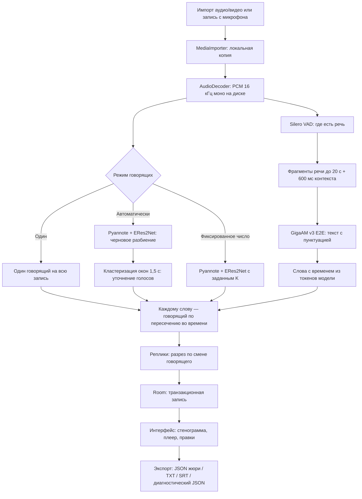

# Архитектура

## Контекст

REPLIKA — Android-приложение, которое превращает запись разговора в текст
с говорящими и временными метками. Вся обработка идёт на телефоне. Интернет
для распознавания не нужен.

Основной сценарий кейса:

1. Пользователь импортирует аудиофайл из памяти телефона или записывает разговор.
2. Приложение находит речь, распознаёт текст и определяет, кто говорит.
3. Результат показывается на экране: реплики, говорящие, время, переход к звуку.
4. Стенограмма экспортируется в JSON по формату жюри, а также в TXT и SRT.

Ограничения кейса, которые определили архитектуру:

- Нельзя отправлять аудио во внешние сервисы и использовать облачные API.
- Проверка: эксперты ставят APK, импортируют записи, экспортируют JSON и
  считают WER (качество текста), DER (качество говорящих) и RTF (скорость).
- Пунктуация и регистр входят в WER.

Приложение — нативный Kotlin и Jetpack Compose. Один Gradle-модуль `:app`,
пакет `ru.replika.offline`, Android 8.0 и выше.

## Компоненты

### Схема обработки записи



### Слои и ключевые файлы

| Слой | Что делает | Ключевые файлы |
| --- | --- | --- |
| Интерфейс | Главная с записью и импортом, библиотека, стенограмма, плеер, правки, Smart Review | [ui/RecordingHome.kt](../app/src/main/java/ru/replika/ui/RecordingHome.kt), [ui/WorkspaceScreen.kt](../app/src/main/java/ru/replika/ui/WorkspaceScreen.kt), [ui/Screens.kt](../app/src/main/java/ru/replika/ui/Screens.kt) |
| Состояние | Запись, импорт, запуск обработки | [ui/AppViewModel.kt](../app/src/main/java/ru/replika/ui/AppViewModel.kt) |
| Импорт и декодирование | Копия файла через системный выборщик, извлечение звука из видео, перевод в 16 кГц моно | [ml/MediaImporter.kt](../app/src/main/java/ru/replika/ml/MediaImporter.kt), [ml/AudioDecoder.kt](../app/src/main/java/ru/replika/ml/AudioDecoder.kt) |
| Фоновая обработка | Весь конвейер в WorkManager, переживает закрытие экрана | [ml/ProcessingWorker.kt](../app/src/main/java/ru/replika/ml/ProcessingWorker.kt) |
| Модели | Распаковка встроенных моделей, проверка SHA-256, общий замок на тяжёлые операции | [ml/BundledModelInstaller.kt](../app/src/main/java/ru/replika/ml/BundledModelInstaller.kt), [ml/ModelManager.kt](../app/src/main/java/ru/replika/ml/ModelManager.kt) |
| Распознавание | Обёртка над sherpa-onnx для GigaAM | [ml/AsrEngine.kt](../app/src/main/java/ru/replika/ml/AsrEngine.kt) |
| Нарезка и слова | Фрагменты речи, контекст, разрез длинных фрагментов, сборка слов из токенов | [domain/VadWordPlanner.kt](../app/src/main/java/ru/replika/domain/VadWordPlanner.kt), [domain/AsrPlan.kt](../app/src/main/java/ru/replika/domain/AsrPlan.kt) |
| Говорящие | Выбор профиля диаризации, кластеризация окон | [domain/DiarizationPlan.kt](../app/src/main/java/ru/replika/domain/DiarizationPlan.kt), [domain/WindowSpeakerRefiner.kt](../app/src/main/java/ru/replika/domain/WindowSpeakerRefiner.kt), [ml/DiarizationRefiner.kt](../app/src/main/java/ru/replika/ml/DiarizationRefiner.kt) |
| Потоки CPU | Выбор числа потоков по ядрам | [domain/CpuPlan.kt](../app/src/main/java/ru/replika/domain/CpuPlan.kt) |
| Хранение | Room: записи, реплики, правки; журнал импорта | [data/Database.kt](../app/src/main/java/ru/replika/data/Database.kt) |
| Экспорт | JSON жюри, TXT, SRT, диагностический JSON | [domain/JuryJson.kt](../app/src/main/java/ru/replika/domain/JuryJson.kt) |

### Порядок работы конвейера

1. **Импорт.** Файл копируется в папку приложения. Исходник не меняется. Из видео
   извлекается только звук. Если импорт прерван, журнал удаляет недописанные файлы.
2. **Декодирование.** Системный MediaCodec переводит звук в PCM 16 кГц моно.
   Стерео усредняется. PCM пишется на диск, а не держится в памяти.
3. **Поиск речи.** Silero VAD отмечает фрагменты речи.
4. **Говорящие.** В автоматическом режиме Pyannote и ERes2Net дают черновое
   разбиение, затем его уточняет кластеризация окон (см. [MODELS.md](MODELS.md)).
   Модели говорящих выгружаются из памяти до загрузки ASR.
5. **Распознавание.** GigaAM получает фрагменты речи до 20 с с 600 мс звука перед
   каждым. Длинный фрагмент режется в самом тихом месте последних 4 с.
6. **Слова и реплики.** Из токенов модели собираются слова со временем
   (шаг модели — 40 мс). Каждое слово получает говорящего по наибольшему
   пересечению с разбиением. Реплика режется там, где меняется говорящий.
7. **Сохранение.** Запись и реплики пишутся в Room одной транзакцией.
   Временный PCM удаляется.

## Основные технические решения

| Решение | Почему |
| --- | --- |
| **Модель ASR не меняли, меняли подачу звука** | GigaAM v3 E2E — лучшая из проверенных открытых русских моделей с пунктуацией. Распознавание целыми фрагментами речи с 600 мс контекста снизило raw WER на dev с 23,26% до 13,32% |
| **Слова, а не отрезки, получают говорящего** | Раньше текст распознавался по отрезкам каждого говорящего, и ошибка диаризации резала фразу. Теперь распознавание и диаризация независимы, а связываются на уровне слов |
| **Своя кластеризация окон поверх sherpa-onnx** | Ни одна из 6 моделей отпечатка голоса и 14 порогов не давала верное число говорящих. Кластеризация окон дала 7 из 8 на dev без новых весов |
| **Ручной режим не меняет поведение** | При заданном числе говорящих или режиме «один говорящий» используется прежняя диаризация V1.6. Новая кластеризация работает только в автоматическом режиме |
| **Модели загружаются по очереди** | Сегментация, отпечаток голоса и ASR не держатся в памяти одновременно. Это снижает пиковую память |
| **Число потоков подбирается само** | 1, 2 или 4 потока, но не больше «ядер минус один» (профиль `auto_v1`). На 8-ядерном телефоне — 4 потока. Результат распознавания от числа потоков не зависит: проверено на 39 прогонах |
| **Термоконтроль** | При статусе перегрева SEVERE и выше обработка ждёт охлаждения перед следующей тяжёлой стадией. Отмена работает и во время ожидания |
| **Все модели внутри APK** | Сборка All-in-One содержит все модели. При первом запуске они распаковываются и проверяются без сети. Размер APK ≈ 840 МБ (русская и английская ASR, определение языка, VAD, диаризация) — организаторы подтвердили, что размер не важен |
| **Строгий JSON для жюри** | Только `transcript` с `speaker_id`, `start_ms`, `end_ms`, `text`. Говорящие нумеруются `speaker_1…N` по первому появлению. Если говорящий слова не определён, оно отдаётся ближайшему по времени. Полная диагностика — в отдельном «Диагностическом JSON» |
| **Старое поведение доступно флагом** | Сборка с `-PreplikaAsrPlan=v16 -PreplikaDiarPlan=v16 -PreplikaCpuPlan=v16` возвращает конвейер V1.6. Старые незавершённые задания продолжают работать по V1.6 |
| **Каждое изменение ML — через стенд** | Параметры меняются только после выигрыша на dev и отсутствия ухудшения на отложенных наборах. См. [TEST_RESULTS.md](TEST_RESULTS.md) |

Пример JSON для жюри (формат, а не результат прогона):

```json
{"transcript":[{"speaker_id":"speaker_1","start_ms":1250,"end_ms":4380,"text":"Добрый день!"}]}
```

## Зависимости

| Слой | Библиотеки и версии |
| --- | --- |
| Язык и сборка | Kotlin 2.1.20, JDK 17, Gradle 8.13, Android Gradle Plugin 8.9.2, KSP 2.1.20-1.0.32 |
| Android | minSdk 26 (Android 8.0), compileSdk и targetSdk 35 |
| Интерфейс | Jetpack Compose BOM 2025.04.01, Material 3 |
| Хранение | Room 2.7.1, DataStore Preferences 1.1.4 |
| Фоновая работа | WorkManager 2.10.1, foreground service `dataSync` |
| Медиа | MediaExtractor, MediaCodec, MediaMuxer (системные), Media3 ExoPlayer 1.6.1 |
| ML | sherpa-onnx 2.0.1 (Apache-2.0), ONNX Runtime 1.28.2 (MIT), готовые `.so` для arm64-v8a и x86_64 |
| Модели | GigaAM v3 E2E, Silero VAD, Pyannote segmentation 3.0, 3D-Speaker ERes2Net — см. [MODELS.md](MODELS.md) |
| Тесты | JUnit 4.13.2, AndroidX Test, Espresso 3.6.1, Compose UI Test |
| Стенд оценки | Python 3.12, зависимости в [tools/eval/requirements.lock.txt](../tools/eval/requirements.lock.txt) |

Версии взяты из [app/build.gradle.kts](../app/build.gradle.kts) и
[gradle-wrapper.properties](../gradle/wrapper/gradle-wrapper.properties).

## Безопасность и приватность

- **Аудио не покидает телефон.** Распознавание, диаризация и экспорт выполняются
  локально. Облачных API и серверной части нет.
- **Интернет не нужен.** Разрешение `INTERNET` есть только для необязательной
  загрузки моделей в обычной сборке. Сборка All-in-One работает в режиме полёта.
  Нешифрованный трафик запрещён (`usesCleartextTraffic=false`).
- **Нет резервного копирования в облако.** `allowBackup=false`: записи
  и стенограммы не попадают в облачный бэкап Android.
- **Разрешения.** Микрофон — для записи. Уведомления и foreground service —
  чтобы обработка не прерывалась в фоне. Доступа ко всем файлам нет: импорт идёт
  через системный выборщик, приложение видит только выбранный файл.
- **Исходник не меняется.** Импорт делает копию. Удаление записи удаляет только
  эту копию.
- **Целостность моделей.** Каждый файл модели проверяется по SHA-256 из
  [models-lock.json](../app/src/main/assets/models-lock.json) перед использованием.
- **Без подстановки ответов.** В приложении нет заготовленных расшифровок
  и правил под тестовые файлы. Эталоны используются только на стенде оценки на ПК.
- **Отладочные данные.** Векторы голосов и токены сохраняются в отдельный файл
  только в тестовой сборке и только по явному флагу. В обычной работе их нет.
- **Ключ подписи.** Ключ `local-dev/debug.keystore` не хранится в Git и не публикуется.
  Это отладочный ключ команды, а не ключ публикации в магазине.
- **Имена говорящих.** `speaker_1…N` — номера внутри одной записи. Это не
  биометрическая идентификация, голоса между записями не сопоставляются.
